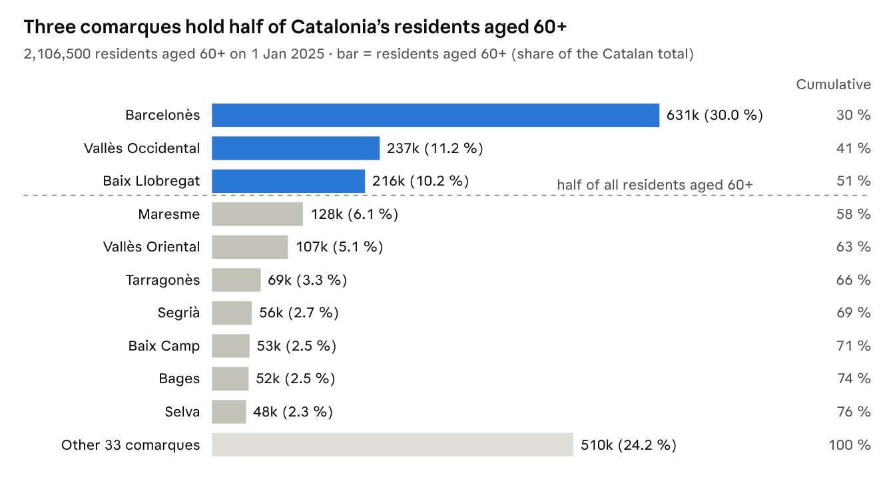
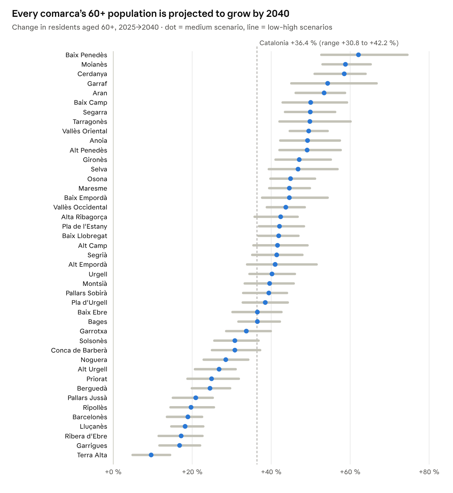

# Notebook 03 — Senior Population by Comarca: Summary and Explanation

*As of 26 November 2026. Exported from the [shared Claude document](https://claude.ai/artifact/Y5NK8jvpTKzHDwob6LZtvg); figures and numbers come from `notebooks/03_comarca_demographics.ipynb`.*

## Purpose

Notebook 03 (`notebooks/03_comarca_demographics.ipynb`) measures how many seniors live in each of Catalonia's 43 comarques (42 comarques + Aran), how that is changing, and how it is projected to change. It is the demographic base of the market study. It does **not** measure demand: living in a comarca and being 60+ does not make anyone a customer.

It answers six questions:

1. **Size.** How many residents aged 60+, 65+ and 75+ live in each comarca on 1 January 2025?
2. **Concentration.** Where do seniors make up the largest share of residents, and how concentrated are they across comarques?
3. **Threshold sensitivity.** Do the comarca rankings change with the age threshold (60+, 65+, 75+)?
4. **Recent trends.** How did the senior population change in 2011–2025 and 2021–2025, within constant boundaries?
5. **Projections.** How is it projected to change up to 2040, according to Idescat's official scenarios?
6. **Context.** How do these figures sit next to household income (2023) and seasonal population (2024)?

The notebook replaces nothing. Notebooks 01–02 (municipal, exploratory) stay unchanged, and 03 avoids their known issues: it removes aggregate rows, joins data by official code and states the year of every indicator.

## Data

All data come from [Idescat](https://www.idescat.cat), the Catalan statistical institute, and are stored unmodified in the repository (`data/raw/`). The API files can be re-downloaded with `scripts/download_idescat.py`, which records each file's link, download time and checksum.

| Dataset | What it gives | Years | Geography |
| --- | --- | --- | --- |
| [Census, population by sex and five-year age](https://www.idescat.cat/pub/?id=censph&n=539) | Current size and share of each age group | 2025 (also 2011, 2021–2024) | Comarca and municipality |
| [Population estimates](https://www.idescat.cat/pub/?id=ep) | Annual series for Catalonia, to fill the census gap | 2012–2025 | Comarca |
| [Population projections, base 2024](https://www.idescat.cat/pub/?id=proj) | Low, medium and high scenarios | 2024–2049 | Comarca |
| [Territorial codes](https://www.idescat.cat/codis/?id=50&n=9) | Which comarca each municipality belongs to | Current | Municipality |
| [Household disposable income (RFDB)](https://www.idescat.cat/pub/?id=rfdbc), provisional | Income per inhabitant, all households | 2023 | Comarca |
| [Seasonal population (ETCA)](https://www.idescat.cat/indicadors/?id=aec&n=15960) | Population load including visitors, all ages | 2024 | Comarca |

All dates are 1 January. The 2025 census file downloaded manually and the same table obtained through the API match exactly (2,904 of 2,904 values).

## Method

Every figure is an exact sum of Idescat's five-year age groups. Because 60, 65 and 75 fall on group boundaries, no interpolation is needed. All methods are descriptive: no model is fitted, no composite "opportunity score" is built, and no causal claims are made.

**Constant boundaries.** Comarca boundaries changed during the period:

- 2015: Moianès was created from parts of Bages, Osona and Vallès Oriental.
- 2023: Lluçanès was created, and Biosca and Torà moved from Segarra to Solsonès.
- July 2025: Aiguafreda moved from Vallès Oriental to Osona ([Llei 7/2025](https://www.boe.es/boe/dias/2025/08/14/pdfs/BOE-A-2025-16832.pdf)).

Idescat publishes each year within the boundaries of that year, so comparing its comarca tables across years would mix real population change with territory changes. The notebook therefore rebuilds every year from **municipal** census data, grouped into the comarques **in force on 1 January 2025**. That is the division used by the 2025 census, the projections, the income data and the seasonal data. Idescat's current code list already applies the Aiguafreda move, so the notebook reverts it explicitly (`src/tfg/territory.py`).

**Validation.** The notebook stops with an error if any of these checks fails:

- Age groups add up to each total, and the 43 comarques add up exactly to Catalonia.
- The rebuilt comarques equal the published ones exactly in 2024 and 2025. In 2011 and 2021–2023 the only differences are the documented boundary changes, plus rounding of a few people in the 2011 census.
- The projections' base year (2024) equals the 2024 census in every comarca and scenario.
- Income and seasonal data cover all 43 comarques.

## Size and concentration (2025)

Catalonia had 2,106,500 residents aged 60+ on 1 January 2025 (25.9 % of residents). Half of them live in just three comarques.

*Source: Idescat, Cens de població i habitatges, 1 Jan 2025 · notebook 03, §6.1–6.3*

The other side of that concentration: 18 comarques have fewer than 10,000 residents aged 60+. The *share* of seniors follows a different pattern. It ranges from 22.1 % (Gironès) to 36.5 % (Terra Alta), and it is highest in small inland and mountain comarques. None of the ten comarques in the chart is among the ten most aged.

## Does the age threshold matter?

It changes the counts a lot but hardly changes which comarques stand out. Catalonia has 2.11 million residents aged 60+, 1.60 million aged 65+ and 0.80 million aged 75+. Yet the comarca rankings are almost the same for all three thresholds:

| Comparison | Ranking by size | Ranking by share |
| --- | --- | --- |
| 60+ vs 65+: rank correlation (Spearman) | 1.00 | 0.98 |
| 60+ vs 75+: rank correlation (Spearman) | 0.998 | 0.92 |
| Comarques in common in the top 10 | 10 of 10 | 9 of 10 |

Terra Alta and Priorat have the highest shares at every threshold. The choice of threshold therefore matters for **market sizing**, but much less for **choosing comarques**, and it can be made later on product grounds.

## Recent trends

Between 2021 and 2025 the 60+ population grew by **169,000 (+8.7 %)**, almost twice as fast as the total population (+4.8 %). It grew in all 43 comarques, and its share of residents rose in 42. The exception is Barcelonès: its 60+ population grew by 4.4 %, but its total population grew faster (+5.7 %).

Growth was fastest around Barcelona and on the coast: Baix Penedès +15.7 %, Aran +14.7 %, Garraf +14.5 %, Moianès +14.0 %. It was slowest in the comarques that are already the most aged: Terra Alta +0.5 %, Ripollès +4.5 %, Garrigues +4.8 %. Across comarques, the higher the senior share, the slower the senior growth (rank correlation −0.70).

Over the longer 2011–2025 period the 60+ population grew by 25 %, and its share rose from 22.3 % to 25.9 %. Terra Alta is the only comarca where it fell. The 2011 census was partly survey-based, so this longer comparison is less reliable than 2021–2025. Idescat's annual estimates show the share rising every year between the census points.

## Projections to 2040

Idescat projects the 60+ population to grow by **+31 % (low), +36 % (medium) and +42 % (high)** between 2025 and 2040. In the medium scenario that means 767,000 more seniors, reaching 2.87 million (32.9 % of residents). The 75+ population grows by about 40 % (medium), to 1.12 million.

*Source: Idescat, Projeccions de població (base 2024), three scenarios · growth computed within each scenario, projected 2025 → 2040 · notebook 03, §6.6*

Growth is positive in every comarca under every scenario. The biggest absolute increases come in the largest comarques: Barcelonès +119,000, Vallès Occidental +103,000 and Baix Llobregat +90,000 (medium). In relative terms, though, Barcelonès and the already-aged inland comarques grow least. The projections mirror recent trends closely (rank correlation 0.93), which is expected because they are built on recent behaviour. They are scenarios, not independent evidence.

## Income and seasonal population

Income and seasonality are only loosely related to the senior figures, and neither measures seniors directly. Both cover all households or all ages, and they refer to 2023 and 2024. They are shown side by side, never combined into a score.

- **Household income per inhabitant (2023, provisional).** It ranges from 15,287 € (Montsià) to 23,632 € (Barcelonès). It tends to be higher where there are more seniors (rank correlation 0.39) and lower where the senior share is high (−0.34). Most of the highly aged inland comarques are below the Catalan average, but Ripollès, Berguedà and Lluçanès are close to it (94–97 % of average).
- **Seasonal population (2024).** It is essentially unrelated to the senior share (0.18). The heaviest seasonal loads are in the Pyrenees (Pallars Sobirà 143 % of residents, Aran 139 %, Alta Ribagorça 133 %) and on the coast (Baix Empordà 134 %, Tarragonès 123 %, Alt Empordà 123 %).

With only 43 comarques, these correlations describe patterns. They are not evidence that one thing causes another, nor a measure of seniors' purchasing power.

## What it means

The senior population falls into two territorial profiles, large-and-growing versus small-and-aged, which may call for different approaches (a hypothesis, see H1). This section keeps measured facts, observations and untested hypotheses apart.

**Facts (measured).**

- 2.11 million residents are 60+. They are concentrated: half live in three comarques, and Barcelonès alone holds 30 %.
- The 60+ population grew in every comarca in 2021–2025, and it is projected to keep growing everywhere until 2040.

**Observations (patterns in the facts).**

- *Large senior populations and aged populations are in different places.* Comarques with the most seniors have average or below-average shares (rank correlation between size and share −0.58). The most aged comarques (Terra Alta, Priorat, Lluçanès, Ripollès, Ribera d'Ebre, Pallars Jussà, Garrigues, Berguedà, all at 33 % or more) each have fewer than 14,000 seniors. Any choice of comarques has to say which of the two it values.
- *Growth is where the numbers already are.* Seniors are being added fastest around Barcelona and on the coast, not in the already-aged interior.
- *The Costa Brava is not demographically exceptional.* Alt Empordà, Baix Empordà and Selva have 39,000–48,000 seniors each, with shares close to average (25.7–27.9 %). Their senior growth is above average and their seasonal load is high. This supports framing the market at Catalonia level rather than around the Costa Brava.

**Hypotheses (not tested yet).**

- H1: Large, dense comarques may have a *discovery* problem: many activities, hard to find. Small, aged comarques may have a *supply and mobility* problem: few activities, poorly publicised and hard to reach. The supply inventory and the survey can test this.
- H2: In highly seasonal comarques, resident-only figures may understate the seniors present for part of the year (second homes, seasonal visitors).
- H3: Fast senior growth around Barcelona may increase demand for activities faster than local supply grows. This needs supply data to assess.

## Limitations

- **Population is not demand.** The figures count residents in an age range. They say nothing about interest in activities, willingness to pay, digital use or current participation. That needs the survey and interviews.
- **Age groups are conventions.** 60+, 65+ and 75+ each mix very different situations (health, work, mobility, digital skills). The 60–74 versus 75+ split is only a first proxy for this.
- **The 2011 census is not fully comparable.** It was partly survey-based and rounded, while 2021 onwards uses a register-based census. 2021–2025 is the reliable comparison.
- **Boundaries are fixed by design.** Trends use the 1 January 2025 division, so they differ from figures Idescat published at the time. The July 2025 Aiguafreda move is not applied.
- **Projections are scenarios, not forecasts.** They depend on Idescat's assumptions about births, deaths and migration. The low–high range shows sensitivity to those assumptions, not statistical confidence. Projections for small comarques are less certain.
- **Residents only.** Seniors who spend part of the year somewhere (second homes, seasonal visitors) are not counted, and the seasonal data is not broken down by age.
- **Comarca averages hide internal differences** (e.g. Barcelona city versus the rest of Barcelonès). Municipal detail is still needed for fieldwork and supply mapping.

## Conclusions and next steps

Demography does not argue against the marketplace, but it does not prove demand either.

1. The potential base is large and growing: 0.8–2.1 million residents depending on the threshold, and +31 % to +42 % (60+) by 2040 in every comarca and scenario.
2. It is concentrated: half of all seniors live in three comarques. Size and share point to different comarques, so both must be reported side by side, never merged into one score.
3. Rankings barely depend on the threshold, so that choice can wait for product decisions.
4. Senior growth is fastest around Barcelona and on the coast, not where the population is already oldest.

**Recommended next steps**

- [ ] Choose comarques for fieldwork that cover both profiles: for example one large metropolitan comarca, one fast-growing coastal one (Baix Empordà or Selva, continuing the Costa Brava case) and one highly aged inland one (Ripollès, Berguedà or Terra Alta).
- [ ] Add context variables from Idescat: people living alone by age, education by age, degree of urbanisation and the territorial socioeconomic index.
- [ ] Analyse municipalities within the chosen comarques.
- [ ] Design the activity-supply inventory (casals, associations, municipal agendas).

**Questions for the tutor**

- Which age threshold should be the main one?
- Should the medium projection scenario be the reference, with low and high as the range?
- Which comarques should be used for fieldwork?

## How to reproduce

The notebook runs top to bottom from a fresh clone of the repository, because the raw data is committed.

1. Install pandas 3.1.0, NumPy 2.5.4, Matplotlib 3.11.2 and Jupyter (all pinned in `requirements.txt`).
2. Open `notebooks/03_comarca_demographics.ipynb` and run all cells.
3. Optional: run `python scripts/download_idescat.py --force` to re-download the Idescat tables. This refreshes the manifest; Idescat may have revised some figures since 26 November 2026.

Outputs:

- Five tables in `data/processed/`: indicators for 2025, trends, projections, the context table, and the municipality-to-comarca mapping.
- Nine figures in `reports/figures/`.

Both folders are regenerated on each run and are not stored in Git. Reusable code is in `src/tfg/`, and every dataset is documented in `docs/data_sources.md`.

**Source:** Idescat — Cens de població i habitatges; Estimacions de població; Projeccions de població (base 2024); Renda familiar disponible bruta territorial; Estimacions de població estacional.
