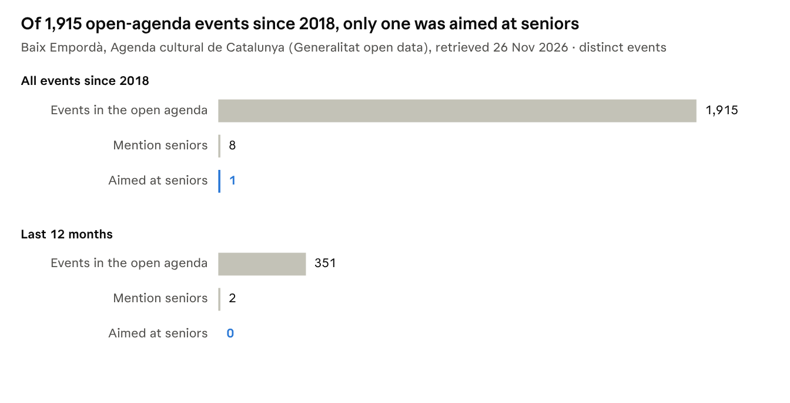

# Notebook 05 — How Visible Is Senior Activity Supply Online? (Baix Empordà)

*As of 26 November 2026. Exported from the [shared Claude document](https://claude.ai/artifact/WYwoKs4bSWKDj8V8XhTJgd); numbers come from `notebooks/05_supply_online_visibility_baix_emporda.ipynb`.*

Online, Baix Empordà has a rich general cultural agenda but almost nothing aimed at seniors. The Generalitat's open agenda listed 351 events in the last 12 months, none of them for seniors, and only one in 1,915 since 2018. The senior offer that does exist (casals, seniors' associations, municipal programmes) is scattered across municipal web pages and offline channels. So an inventory built only from online sources would badly undercount it.

## Why and how

Baix Empordà was chosen because it is the proposed fieldwork comarca for the seasonal coastal profile (P2) and continues the Costa Brava case. It also has 36 municipalities of very different sizes, home to 40,463 residents aged 60+. The study measures **online visibility**, not existence: a missing listing does not mean a missing activity.

| Source | What was checked | Notes |
| --- | --- | --- |
| [Agenda cultural de Catalunya](https://analisi.transparenciacatalunya.cat/d/rhpv-yr4f) (Generalitat open data) | All events located in the comarca; how many mention or target seniors | 1,915 distinct events since 2018 |
| [Equipaments de Catalunya](https://analisi.transparenciacatalunya.cat/d/8gmd-gz7i) | Whether casals de gent gran are registered | 784 facilities in the comarca |
| [Registre d'entitats, serveis i establiments socials](https://analisi.transparenciacatalunya.cat/d/ivft-vegh) | Services for older people | 83 social services |
| The 36 town hall websites ([addresses from the Generalitat register](https://analisi.transparenciacatalunya.cat/d/vevv-8fvw)) | Automated check: does the homepage link to an agenda or a seniors/casal page; does the agenda mention seniors | One homepage request + one agenda request per site; 29 of 36 reachable |

Everything was retrieved on 26 November 2026 with two scripts in the repository, so the check can be repeated for other comarques. No page copies or personal data were stored.

## The open cultural agenda

The agenda is active and covers almost the whole comarca: 351 events in the last 12 months, in 24 of 36 municipalities, where 96.5 % of the comarca's seniors live. But it has virtually nothing for seniors.

*Source: Generalitat de Catalunya, Agenda cultural de Catalunya (per localitzacions), Baix Empordà, retrieved 26 Nov 2026 · notebook 05*

The events that "mention seniors" are six carnival parades and one traditional gathering (aplec) whose descriptions mention seniors. They are general-public events. The single event aimed at seniors was the 40th anniversary of the Associació Palamós Gent Gran (2022). The agenda's most common categories are children's events, theatre, concerts, festivals and guided visits. Five towns account for 63 % of the municipal event counts.

## Registers and municipal websites

Official registers see seniors almost only as recipients of care. Town hall websites are the best online source, but only a few have a page for seniors.

- **Facility register.** No Baix Empordà facility is in the category "Casals de gent gran". In the whole of Catalonia that category holds just 16 facilities across 7 comarques, so the register is clearly incomplete for this type. Two senior leisure venues appear under generic cultural categories: the Llar del Jubilat El Recer (Torroella de Montgrí) and the Casal de Jubilats (Verges).
- **Social-services register.** It lists 25 services for older people in the comarca (14 residences, 9 day centres, 2 residential homes). All are care, not leisure.
- **Town hall websites.** 29 of 36 could be checked automatically; 7 blocked the request or did not respond. Of the 29:
  - 25 link to an activities agenda.
  - 5 link to a seniors or casal page: Begur, Castell-Platja d'Aro, Palamós, Pals, Torroella de Montgrí.
  - 3 agenda pages mention seniors.

None of the 20 municipalities with fewer than 1,000 residents has a seniors page.

| Signal | % of the comarca's residents aged 60+ living in municipalities with it |
| --- | --- |
| Events in the open agenda (last 12 months) | 96.5 % |
| Website links to an agenda | 63.1 % |
| Website links to a seniors page | 36.1 % |
| Website agenda mentions seniors | 14.2 % |
| Senior leisure venue in the facility register | 9.2 % |

## What it means

The senior offer exists, but it is fragmented and mostly invisible in shared online channels. That points to an information problem worth testing, not yet a proven need.

**Facts.** Only 1 of 1,915 open-agenda events was aimed at seniors, and none in the last 12 months. No casals de gent gran are registered in the comarca. Only 5 of 29 checked town hall websites have a seniors page.

**Observations.**

- *General culture is visible; senior-specific supply is not.* Nearly all seniors live where the open agenda has events, but only 9–36 % live where any senior-specific signal appears.
- *What exists is scattered.* A seniors' association in Palamós, the Llar del Jubilat in Torroella and the Casal de Jubilats in Verges appear in official sources. Begur, Pals and others have senior pages. Yet none of this reaches the shared agenda.

**Hypotheses to test.**

- **H7:** Senior activities exist but are hard to find online. If confirmed, this would support an *information-aggregation* value proposition. It would not show that seniors want a digital channel: at 65–74 only 36 % buy online (notebook 04).
- **H8:** Casals and seniors' associations publicise mainly offline (noticeboards, meetings, WhatsApp, word of mouth), so they can only be inventoried by direct contact.
- **H9:** Small municipalities rely on provision at comarca level or shared with neighbouring towns.

## Limitations

- **Visibility is not existence.** Everything here measures what can be found online with these sources.
- **The open agenda is voluntary.** Organisers choose whether to publish there, and its use grew strongly after 2021.
- **The keyword search is narrow.** Activities described without words such as "gent gran", "sènior" or "jubilats" are missed (e.g. "gimnàstica de manteniment", "tai-txi").
- **The website check is shallow.** It reads one homepage and one agenda page; content loaded by JavaScript, PDFs and social media is not seen. Seven sites could not be checked.
- **One comarca, one day.** The results may not transfer to metropolitan or rural comarques.

## Next steps for the supply inventory

- [ ] Define the inventory fields: organiser, type, activity, category, stated audience, price, frequency, place, **publicity channel** (online / offline), source, date collected.
- [ ] Pilot in Baix Empordà. Read the 5 municipal senior pages and the 3 agenda pages manually. Contact the casals and seniors' associations of Torroella de Montgrí, Verges, Palamós and Begur, and the Consell Comarcal's social services.
- [ ] Repeat the same online check in Vallès Occidental (P1) and Berguedà (P4) to compare profiles; the scripts are reusable.
- [ ] Add to the survey: *how do you find out about activities today?* and *would you use a single listing?*
